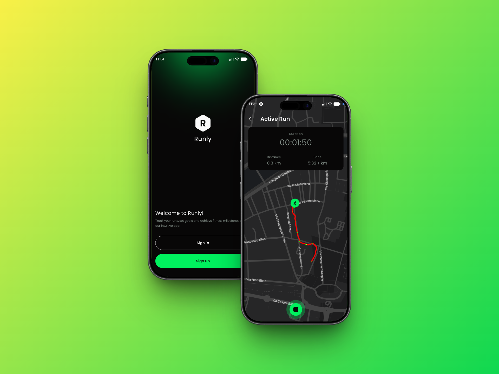

<div align="center">

# 🏃 Runly

**Track every run, online or offline.**

Offline-first Android running tracker with live GPS tracking,
real-time stats and automatic background sync with the back-end.


-orange)


</div>

---

## 📖 Overview

**Runly** is a native Android app for tracking your runs. Start a run, follow
your route live on the map and watch distance, pace and duration update in
real time — even with the screen off or the app closed, thanks to a
foreground service. Every run is saved **locally first**, so the app keeps
working without an internet connection, and everything is synced with the
back-end as soon as the network comes back.

## ✨ Key features

- 🔐 **Authentication** — sign up and log in, with tokens kept in encrypted
  storage and refreshed automatically when they expire.
- 🗺️ **Live run tracking** — your route drawn on Google Maps, with distance,
  pace and elapsed time updated in real time. Pause and resume at any moment.
- 📲 **Background tracking** — a foreground service keeps the run going even
  when the app is in the background or removed from recents.
- 📋 **Run overview** — all your saved runs with their stats in one list.
- 📴 **Offline-first** — runs are always available, with or without a
  connection (see below).
- 🔗 **Deep links** — `runly://active_run` takes you straight back to the
  ongoing run.

## 📸 Screenshots



## 📴 Offline-first

The local database is the **single source of truth**: the UI only ever reads
from Room, so the app behaves the same way with or without a connection.

- 💾 **Local first** — a finished run is written to the database immediately
  and shows up in the list right away, even when offline.
- 🕒 **Pending sync queue** — if a run can't be uploaded (or deleted) on the
  server, the operation is stored in a dedicated sync table instead of being
  lost.
- 🔄 **Background sync** — **WorkManager** workers upload pending runs,
  propagate pending deletions and periodically fetch runs from the back-end.
  They run only when the network is available and retry automatically on
  failure.
- ⚡ **Reactive UI** — once synced, remote data is written back to the local
  database and the UI updates automatically through Kotlin Flows.

## 🏗️ Architecture

**Multi-module clean architecture**: each feature is split into `domain`,
`data` and `presentation` layers, with shared code in `core`. The
presentation layer follows an **MVI-style** pattern (State / Action / Event),
dependencies are injected with **Koin**, and the shared Gradle setup lives in
**convention plugins**.

```
app/                    → entry point, navigation, DI wiring

auth/
├── domain/             → pure Kotlin: repository contracts, validation
├── data/               → Ktor-based implementations
└── presentation/       → intro, login and register screens

run/
├── domain/             → pure Kotlin: RunningTracker, distance/pace logic
├── data/               → WorkManager sync workers
├── network/            → remote data source (Ktor)
├── location/           → GPS via Fused Location Provider
└── presentation/       → run overview, active run, foreground service

core/
├── domain/             → shared models, Result & error types
├── data/               → HTTP client, encrypted session storage
├── database/           → Room database, DAOs, sync entities
└── presentation/
    ├── designsystem/   → theme and reusable components
    └── ui/             → shared UI utilities

build-logic/            → Gradle convention plugins
```

## 🛠️ Tech stack

| Category | Library |
|---|---|
| Language | Kotlin + Coroutines / Flow |
| UI | Jetpack Compose (BOM) + Material 3 |
| Navigation | Navigation 3 (`androidx.navigation3`) |
| Persistence | Room |
| Background sync | WorkManager |
| Networking | Ktor Client |
| Dependency injection | Koin |
| Maps | Google Maps Compose |
| Location | Play Services Location |
| Serialization | Kotlinx Serialization |

## 📋 Requirements

- **minSdk** 29 (Android 10)
- **compileSdk / targetSdk** 37 / 37
- **AGP** 9.2.1
- **JDK** 17
- A Google Maps API key and a back-end API key

## 🚀 Setup & build

1. Clone the repository:

   ```bash
   git clone https://github.com/giorgio-micheli/Runly.git
   ```

2. Add your keys to `local.properties` in the project root (this file is
   ignored by git):

   ```properties
   API_KEY=your_backend_api_key
   MAPS_API_KEY=your_google_maps_api_key
   ```

3. Build and run with the standard Gradle commands, from the repo root:

   ```bash
   # Build & install
   ./gradlew assembleDebug          # build debug APK
   ./gradlew installDebug           # build and install on connected device/emulator

   # Unit tests (local JVM)
   ./gradlew test

   # Instrumented tests (requires device/emulator)
   ./gradlew connectedAndroidTest

   # Android lint
   ./gradlew lint
   ```

<div align="center">

Made with 💚 in Kotlin & Jetpack Compose

</div>
